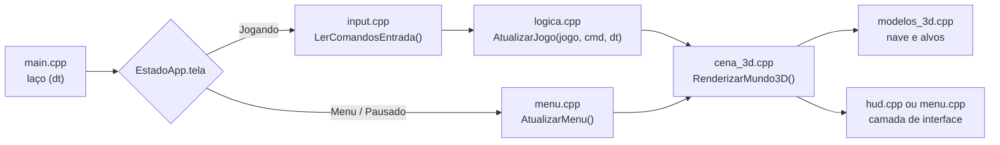

# Space Combat 3D - Computação Gráfica

Jogo de combate espacial tridimensional em **C++17** com **Raylib** e **OpenGL (`rlgl`)**, desenvolvido para a disciplina de Computação Gráfica.

O projeto demonstra, de forma interativa, o pipeline gráfico 3D em tempo real: modelagem poligonal explícita por vértices e cores (`RL_TRIANGLES`), transformações geométricas compostas e hierárquicas na pilha de matrizes (`rlPushMatrix` / `rlPopMatrix`), câmeras sintéticas (Matriz de Visualização), projeção perspectiva, projeção mundo → tela e colisão contínua.

---

## 📁 Estrutura de Pastas

O código fica em `src/`, dividido em **4 pastas temáticas**. A pasta `build/` é gerada na compilação.

```text
computacao-grafica/
├── Makefile                       # Compilação incremental (gera o binário space_combat)
├── README.md
└── src/
    ├── main.cpp                   # Janela OpenGL (MSAA 4x) e laço principal
    ├── core/                      # Dados, constantes e matemática
    │   ├── entidades.h / .cpp     # Entidades 3D, JogoEstado, Config e funções matemáticas
    │   └── estado.h / .cpp        # Tela ativa (menu / jogando / pausado) e controle do cursor
    ├── input/                     # Periféricos
    │   └── input.h / .cpp         # Teclado, mouse e gamepad -> ComandosEntrada
    ├── fisica/                    # Simulação
    │   └── logica.h / .cpp        # Voo, disparo, colisões, ondas, anéis, partículas e câmera
    └── render/                    # Desenho
        ├── modelos_3d.h / .cpp    # Malha triangular da nave e transformações dos alvos
        ├── cena_3d.h / .cpp       # Passe 3D (BeginMode3D) e pilha de matrizes
        ├── hud.h / .cpp           # Mira projetada, marcadores de alvos e painel de CG
        └── menu.h / .cpp          # Menu principal, submenus e menu de pausa
```

### Responsabilidade de cada pasta

- **`core/`** – Estruturas (`Nave3D`, `Alvo3D`, `Projetil3D`, `Particula3D`, `AnelCheckpoint`, `Estrela3D`), o estado da simulação (`JogoEstado`) e **todas as constantes** do jogo no namespace `Config`. Contém a matemática compartilhada: base ortonormal da nave, suavização independente de FPS, interseção segmento × esfera. Separa o estado da **simulação** (`JogoEstado`) do estado da **aplicação** (`EstadoApp`: qual tela está ativa).
- **`input/`** – Lê teclado, mouse e gamepad e entrega um único `ComandosEntrada` normalizado. A física não conhece o hardware.
- **`fisica/`** – A cada quadro: voo (ângulos de Euler + banking), disparo, colisão dos lasers, ondas, anéis, partículas e câmera. Cada etapa é uma função própria.
- **`render/`** – Só desenha: modelos, cena 3D, HUD e menus.

### Fluxo por quadro



---

## 🎤 Roteiro dos Módulos

| Ordem | Arquivo | O que explicar |
|---|---|---|
| **1º** | [`src/main.cpp`](src/main.cpp) | Janela com anti-aliasing (`FLAG_MSAA_4X_HINT`), os dois estados (`JogoEstado` e `EstadoApp`) e o laço: atualizar conforme a tela, desenhar o mundo 3D e, por cima, a camada de interface. |
| **2º** | [`src/core/entidades.*`](src/core/entidades.h) | Entidades no $\mathbb{R}^3$; base ortonormal da nave (`CalcularOrientacaoNave`); conversão de coordenadas esféricas $(r, \theta, \phi)$ para cartesianas; `Config` com todos os parâmetros. |
| **3º** | [`src/input/input.*`](src/input/input.h) | Entrada unificada com zona morta (*deadzone*) nos analógicos e vibração (*rumble*). O mouse só atira e aciona o nitro; turbo tem prioridade sobre freio. |
| **4º** | [`src/render/modelos_3d.cpp`](src/render/modelos_3d.cpp) | **Modelagem poligonal explícita** da nave (`rlBegin(RL_TRIANGLES)`, `rlVertex3f`, `rlColor3f`) e **transformações hierárquicas** $M = T \cdot R_y \cdot R_x \cdot R_z \cdot S$ nos alvos, com sub-rotações nos anéis orbitais. |
| **5º** | [`src/render/cena_3d.cpp`](src/render/cena_3d.cpp) | `BeginMode3D` (projeção perspectiva + matriz de visualização), pilha de matrizes para cada objeto, anéis posicionados com $T \cdot R_y \cdot R_z$, cúpula da arena e partículas. |
| **6º** | [`src/fisica/logica.cpp`](src/fisica/logica.cpp) | Ângulos de Euler, suavização exponencial, convergência dos lasers, **colisão segmento × esfera**, **travessia de plano** nos anéis e os 3 modos de câmera. |
| **7º** | [`src/render/hud.cpp`](src/render/hud.cpp) | `GetWorldToScreen` para a mira e os marcadores; produto escalar para descartar alvos atrás da câmera. |
| **8º** | [`src/render/menu.cpp`](src/render/menu.cpp) e [`src/core/estado.*`](src/core/estado.h) | Máquina de estados das telas e botões em modo imediato. |

---

## 🚀 Como Compilar e Executar

### Pré-requisitos
- Compilador C++ com suporte a C++17 (`g++`)
- Biblioteca **Raylib**:
  - **Fedora:** `sudo dnf install raylib-devel`
  - **Debian / Ubuntu:** `sudo apt install libraylib-dev`
  - **Arch Linux:** `sudo pacman -S raylib`

### Comandos

```bash
make         # compila (incremental, em build/) e gera ./space_combat
make run     # compila e executa
make clean   # remove build/ e o executável
```

---

## 🎮 Controles

O voo é feito por **teclado** (ou gamepad). O **mouse** só atira e aciona o nitro; mover o mouse não gira a nave.

| Ação | Teclado | Mouse | Gamepad | Descrição |
|---|---|---|---|---|
| **Arfagem (Pitch)** | `W` / `S` ou `▲` / `▼` | — | Analógico esq. (Y) ou D-Pad | Nariz sobe/desce (eixo $X$), limitado a $\pm 85^\circ$ contra *gimbal lock* |
| **Guinada (Yaw)** | `A` / `D` ou `◀` / `▶` | — | Analógico esq. (X) ou D-Pad | Vira à esquerda/direita (eixo $Y$) com *banking* automático |
| **Rolagem (Roll)** | `Q` / `E` | — | Analógico dir. (X) ou `LB` / `RB` | Inclinação manual das asas (eixo $Z$) |
| **Laser** | `ESPAÇO` | Botão esquerdo | `A` / `X` | Dois lasers das pontas das asas, convergindo na mira |
| **Nitro** | `SHIFT` | Botão direito | `RT` ou `B` | Velocidade de cruzeiro ($14$) sobe para $32$ e as chamas aumentam |
| **Freio** | `CTRL` | — | `LT` | Reduz a velocidade para $5$. Se pedir nitro e freio juntos, o nitro vence |
| **Câmera** | `C` ou `TAB` | — | `Y` | Chase → Cockpit → Orbital |
| **Inverter eixo Y** | `I` | — | `L3` | Alterna pitch direto e invertido (estilo aviação) |
| **Painel didático** | `H` | — | `Select` | Mostra/oculta o painel de CG |
| **Pausar** | `ESC` | — | `Start` | Abre o menu de pausa (`ESC` de novo continua) |
| **Reiniciar** | `R` | — | — | Reinicia a missão |

No menu principal, **"Iniciar Missão"** sempre começa uma missão nova.

---

## 📐 Conceitos de CG

### 1. Pipeline de modelagem: $M = T \cdot R_y \cdot R_x \cdot R_z \cdot S$
Cada objeto é definido no **espaço de objeto** (centrado na origem) e levado ao **espaço do mundo** pela pilha de matrizes do OpenGL/rlgl:
1. `rlPushMatrix()` salva a matriz atual.
2. `rlTranslatef` aplica a translação $T$.
3. `rlRotatef` aplica as rotações de Euler em $Y$ (yaw), $X$ (pitch) e $Z$ (roll).
4. `rlScalef` aplica a escala $S$.
5. `rlPopMatrix()` restaura a matriz, isolando a transformação de cada objeto.

> **Nota sobre convenções.** Em `CalcularOrientacaoNave`, o raymath multiplica vetores-linha (`MatrixMultiply(A, B)` aplica $A$ e depois $B$): $R_z$, depois $R_x$, depois $R_y$. No OpenGL a matriz $M = T \cdot R_y \cdot R_x \cdot R_z \cdot S$ usa vetores-coluna e também aplica $R_z$ primeiro. São a **mesma** rotação, escrita nas duas convenções.

### 2. Escala harmônica e hierarquia nos alvos
$$S(t) = S_{\text{base}} \cdot \left(1 + 0.20 \cdot \sin(3t + 1.3\,\text{id})\right)$$
No **Drone Sentinela**, depois de $T \cdot R \cdot S$, novos `rlPushMatrix()` / `rlPopMatrix()` empilham rotações próprias para girar dois anéis orbitais ao redor do núcleo.

### 3. Matriz de visualização (`Camera3D` / LookAt)
Definida por $(\vec{E}_{\text{position}}, \vec{T}_{\text{target}}, \vec{U}_{\text{up}})$:
- **Chase (3ª pessoa):** posição desejada $\vec{P}_{\text{nave}} - 7.5\,\vec{F} + 2.6\,\vec{U}$, alcançada por interpolação com **suavização exponencial**.
- **Cockpit (1ª pessoa):** ancorada na canópia, com o `up` da câmera igual ao `up` da nave, de modo que o horizonte gira junto com o *roll*.
- **Orbital (tática):** deslocada $(0, 32, -24)$ da nave, com `up` fixo em $(0, 1, 0)$.

**Suavização independente de FPS.** `Lerp(a, b, k·dt)` ultrapassa o alvo quando $dt$ é grande (por exemplo $14 \times 0.1 = 1.4 > 1$). O projeto usa o fator
$$f = 1 - e^{-k\,dt} \in [0, 1)$$
que nunca passa do alvo e tem a mesma "sensação" em qualquer FPS.

### 4. Projeção perspectiva e transformação mundo → tela
- A cena usa projeção perspectiva (`CAMERA_PERSPECTIVE`) com $FOV_y = 60^\circ$: objetos distantes aparecem menores (*foreshortening*).
- `GetWorldToScreen` aplica `View × Projection` e converte para pixels. O retículo é projetado no **ponto de convergência dos lasers**, $45$ unidades à frente da nave (a mesma constante `Config::DISTANCIA_CONVERGENCIA` é usada no HUD e no disparo). Os marcadores dos alvos têm tamanho inversamente proporcional à distância ($400 / d$).

### 5. Convergência dos lasers
Cada canhão (nas pontas das asas) dispara em direção ao ponto focal $\vec{P}_f = \vec{P}_{\text{nave}} + D\,\vec{F}$:
$$\vec{d}_i = \frac{\vec{P}_f - \vec{C}_i}{\lVert \vec{P}_f - \vec{C}_i \rVert}$$
Assim os dois feixes se cruzam exatamente sob a mira.

### 6. Colisão contínua (segmento × esfera)
Um laser a $95$ u/s anda vários metros por quadro e poderia atravessar um alvo pequeno entre dois quadros. Em vez de testar só o ponto final, testa-se o **segmento** $[\vec{A}, \vec{B}]$ percorrido: projeta-se o centro $\vec{C}$ no segmento,
$$t = \operatorname{clamp}\!\left(\frac{(\vec{C}-\vec{A})\cdot(\vec{B}-\vec{A})}{\lVert \vec{B}-\vec{A} \rVert^2},\,0,\,1\right)$$
e compara-se a distância de $\vec{C}$ ao ponto mais próximo com o raio.

### 7. Anéis de checkpoint (travessia de plano)
O anel é um disco vertical, com normal $\vec{n}$ apontando na direção radial. A nave só pontua se **atravessar** o plano dentro da abertura: as distâncias com sinal $d_0 = (\vec{P}_{\text{ant}} - \vec{C})\cdot\vec{n}$ e $d_1 = (\vec{P}_{\text{atual}} - \vec{C})\cdot\vec{n}$ devem ter sinais opostos, e o ponto do cruzamento, $\vec{P}_{\text{ant}} + \frac{d_0}{d_0 - d_1}(\vec{P}_{\text{atual}} - \vec{P}_{\text{ant}})$, deve estar a menos de `raio` do centro.
