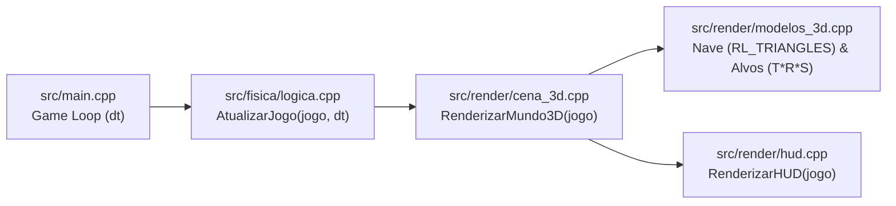

# Space Combat 3D - Computação Gráfica

Simulador e jogo de combate espacial tridimensional desenvolvido em **C++17** com **Raylib** e **OpenGL (`rlgl`)** para a disciplina de Computação Gráfica.

O projeto demonstra de forma prática e interativa o pipeline gráfico 3D em tempo real: modelagem poligonal explícita por vértices e cores (`RL_TRIANGLES`), transformações geométricas compostas e hierárquicas na pilha de matrizes (`rlPushMatrix` / `rlPopMatrix`), câmeras sintéticas (Matriz de Visualização), projeção perspectiva e projeção de coordenadas do espaço do mundo na tela.

---

## 📁 Estrutura de Pastas do Projeto

O repositório foi modularizado separando cabeçalhos (`.h`) e implementações (`.cpp`) em **3 subpastas temáticas** dentro de `src/` (`core/`, `fisica/`, `render/`), além da pasta `build/` gerada automaticamente durante a compilação:

```text
computacao-grafica/
├── Makefile                       # Script de compilação incremental (gera o binário space_combat)
├── README.md                      # Documentação da arquitetura, controles e conceitos de CG
└── src/
    ├── main.cpp                   # Inicialização da janela OpenGL (MSAA 4x) e Game Loop principal
    ├── core/                      # [Núcleo de Dados e Matemática Vetorial]
    │   ├── entidades.h            # Structs 3D, enums (ModoCamera, TipoAlvo), JogoEstado e Config
    │   └── entidades.cpp          # Base ortonormal (Matriz de Rotação) e geração em coord. esféricas
    ├── fisica/                    # [Simulação Física, Controles e Câmera]
    │   ├── logica.h               # Interface de atualização física e lógica
    │   └── logica.cpp             # Voo 3D (Euler + Lerp), colisão Ponto-Esfera, partículas e Câmera 3D
    └── render/                    # [Pipeline de Renderização OpenGL / rlgl e Interface]
        ├── modelos_3d.h / .cpp    # Malha triangular explícita da nave e matrizes T*R*S dos alvos
        ├── cena_3d.h / .cpp       # Montagem e renderização do Mundo 3D (BeginMode3D e pilha rlgl)
        └── hud.h / .cpp           # Projeção Mundo->Tela (GetWorldToScreen), mira 3D e painel de CG
```

### Divisão de Responsabilidades por Pasta

- **`src/core/` (Núcleo e Matemática 3D):**
  Centraliza todas as estruturas de dados (`Nave3D`, `Alvo3D`, `Projetil3D`, `Particula3D`, `AnelCheckpoint`, `Estrela3D`) e encapsula o estado da simulação na struct `JogoEstado` (eliminando variáveis globais soltas). Contém o cálculo dos vetores diretores da nave (`Forward`, `Up`, `Right`) por multiplicação de matrizes de rotação e a geração procedural em coordenadas esféricas e cilíndricas.
- **`src/fisica/` (Dinâmica de Voo, Colisões e Matriz de Visualização):**
  Processa as entradas do jogador, atualiza os ângulos de Euler (`pitch`, `yaw`, `roll`) com amortecimento inercial (`Lerp`), propaga os projéteis laser, realiza a detecção de colisão esférica (*Bounding Sphere*), atualiza o sistema de partículas volumétricas e calcula os vetores `LookAt` (`position`, `target`, `up`) dos 3 modos de câmera.
- **`src/render/` (Modelagem Poligonal, Cena 3D e HUD):**
  Separado em três módulos enxutos:
  1. `modelos_3d`: Desenha a malha de triângulos 3D da nave (`rlBegin(RL_TRIANGLES)`) e aplica as transformações compostas e hierárquicas dos alvos inimigos.
  2. `cena_3d`: Ativa a projeção perspectiva (`BeginMode3D`), posiciona todas as entidades no mundo usando `rlPushMatrix()` / `rlPopMatrix()` e renderiza as explosões de partículas.
  3. `hud`: Projeta pontos 3D na tela (`GetWorldToScreen`) para desenhar o retículo de mira à frente da nave, os marcadores holográficos dos alvos e o painel didático de Computação Gráfica.

### Fluxo de Execução por Quadro (*Frame Pipeline*)



---

## Módulos

| Ordem | Arquivo | Conceito de Computação Gráfica |
|---|---|---|
| **1º** | [`src/main.cpp`](src/main.cpp) | Configuração da janela OpenGL com Anti-Aliasing (`FLAG_MSAA_4X_HINT`), instanciação de `JogoEstado` e separação entre `AtualizarJogo`, `RenderizarMundo3D` e `RenderizarHUD`. |
| **2º** | [`src/core/entidades.h`](src/core/entidades.h)<br>[`src/core/entidades.cpp`](src/core/entidades.cpp) | Representação das entidades no $\mathbb{R}^3$, cálculo da base ortonormal da nave (`Forward`, `Up`, `Right`) multiplicando os eixos canônicos pela matriz composta $R = R_z(\text{roll}) \cdot R_x(-\text{pitch}) \cdot R_y(\text{yaw})$ em `CalcularOrientacaoNave`, e conversão de coordenadas esféricas $(r, \theta, \phi)$ para cartesianas $(x, y, z)$. |
| **3º** | [`src/render/modelos_3d.cpp`](src/render/modelos_3d.cpp) | **Modelagem Poligonal Explícita:** construção da nave vértice a vértice com `rlBegin(RL_TRIANGLES)`, `rlVertex3f` e `rlColor3f`/`rlColor4f` (`DesenharGeometriaNave3D`).<br>**Transformações Hierárquicas:** aplicação de $M = T \cdot R_y \cdot R_x \cdot R_z \cdot S$ nos alvos (`DesenharAlvo3D`) e sub-rotações nos anéis orbitais com `rlPushMatrix()` e `rlPopMatrix()`. |
| **4º** | [`src/render/cena_3d.cpp`](src/render/cena_3d.cpp) | Ativação da Matriz de Projeção Perspectiva e Matriz de Visualização (`BeginMode3D`), desativação de *backface culling* (`rlDisableBackfaceCulling`), posicionamento da nave no espaço do mundo e renderização das partículas volumétricas 3D. |
| **5º** | [`src/fisica/logica.cpp`](src/fisica/logica.cpp) | Dinâmica de voo com ângulos de Euler (`pitch`, `yaw`, `roll`), amortecimento inercial (`Lerp`), detecção de colisão esférica (*Bounding Sphere*) e cálculo dos 3 modos de câmera (`Chase`, `Cockpit`, `Orbital`) com *Screen Shake*. |
| **6º** | [`src/render/hud.cpp`](src/render/hud.cpp) | Projeção do espaço do mundo 3D para a tela (`GetWorldToScreen`) para desenhar o retículo de mira e os *brackets* dos alvos, usando produto escalar (`Vector3DotProduct`) para descartar alvos atrás da câmera. |

---

## 🚀 Como Compilar e Executar

### Pré-requisitos
- Compilador C++ com suporte a C++17 (`g++`)
- Biblioteca **Raylib** instalada no sistema:
  - **Fedora:** `sudo dnf install raylib-devel`
  - **Debian / Ubuntu:** `sudo apt install libraylib-dev`
  - **Arch Linux:** `sudo pacman -S raylib`

### Comandos do `Makefile`

Compilar o projeto (compilação incremental em `build/`, gerando o binário `space_combat`):
```bash
make
```

Compilar e executar imediatamente:
```bash
make run
# ou diretamente:
./space_combat
```

Limpar arquivos objeto e executável:
```bash
make clean
```

---

## 🎮 Controles de Voo e Câmera

| Ação | Teclas | Descrição Técnica |
|---|---|---|
| **Arfagem (Pitch)** | `W` / `S` ou `▲` / `▼` | Rotaciona o nariz da nave para cima/baixo em torno do eixo local $X$ (limitado a $\pm 85^\circ$ contra *Gimbal Lock*) |
| **Guinada (Yaw)** | `A` / `D` ou `◀` / `▶` | Rotaciona a nave para a esquerda/direita no eixo $Y$ induzindo *banking* automático no eixo $Z$ |
| **Rolagem (Roll)** | `Q` / `E` | Inclina manualmente as asas ao redor do eixo longitudinal $Z$ |
| **Canhões Laser** | `ESPAÇO` ou `Botão Esquerdo do Mouse` | Dispara feixes duplos 3D a partir da posição transformada das pontas das asas |
| **Turbo / Pós-combustor** | `SHIFT ESQUERDO` | Eleva a velocidade escalar de cruzeiro ($12 \to 28$) e expande a escala dos jatos de plasma |
| **Freio Espacial** | `CTRL ESQUERDO` | Reduz a velocidade escalar ($12 \to 4$) para mira e manobras curtas |
| **Alternar Câmera** | `C` ou `TAB` | Alterna entre **3ª Pessoa (Chase)**, **1ª Pessoa (Cockpit)** e **Tática (Orbital)** |
| **Inverter Manche (Eixo Y)** | `I` | Alterna entre arfagem invertida (padrão de aviação) e direta |
| **Painel Didático de CG** | `H` | Exibe ou oculta o painel inferior direito com a fórmula do pipeline e ângulos em tempo real |
| **Reiniciar Simulação** | `R` | Restaura posição da nave, câmera, pontuação, ondas e anéis de checkpoint |

---

## 📐 Detalhamento Teórico dos Conceitos de CG

### 1. Pipeline de Transformações de Modelagem ($M = T \cdot R_y \cdot R_x \cdot R_z \cdot S$)
Cada objeto 3D é definido em seu próprio **Espaço de Objeto (Local Space)** centrado na origem $(0,0,0)$ e posicionado no **Espaço do Mundo (World Space)** através da pilha de matrizes OpenGL/rlgl:
1. `rlPushMatrix()`: Salva a matriz ModelView atual no topo da pilha.
2. `rlTranslatef(x, y, z)`: Aplica a matriz de translação $T$.
3. `rlRotatef(...)`: Aplica as rotações de Euler nos eixos $Y$ (Yaw), $X$ (Pitch) e $Z$ (Roll).
4. `rlScalef(sx, sy, sz)`: Aplica a escala tridimensional $S$.
5. `rlPopMatrix()`: Restaura a matriz anterior, impedindo que a transformação de um objeto afete os demais.

### 2. Escala Harmônica e Transformações Hierárquicas nos Alvos
Os alvos utilizam uma função senoidal contínua para pulsar no espaço 3D:
$$S(t) = S_{\text{base}} \cdot \left(1 + 0.20 \cdot \sin(3t + 1.3\,\text{id})\right)$$
No caso do **Drone Sentinela**, após aplicar a matriz $T \cdot R \cdot S$ do corpo principal, novos blocos `rlPushMatrix()` / `rlPopMatrix()` empilham rotações independentes para fazer dois anéis orbitais girarem em eixos cruzados ao redor do núcleo.

### 3. Matriz de Visualização (`Camera3D` / LookAt)
A câmera sintética é definida pelos vetores $(\vec{E}_{\text{position}}, \vec{T}_{\text{target}}, \vec{U}_{\text{up}})$:
- **Chase Cam (3ª Pessoa):** Calcula a posição desejada atrás e acima da nave ($\vec{P}_{\text{nave}} - 7.5\,\vec{F} + 2.6\,\vec{U}$) e aplica interpolação linear (`Vector3Lerp`) a cada quadro para criar efeito de amortecimento inercial.
- **Cockpit Cam (1ª Pessoa):** Ancora a câmera sobre a canópia da nave e alinha o vetor $\vec{U}_{\text{up}}$ da câmera com o vetor `Up` rotacionado da nave, fazendo o horizonte girar junto com o `roll`.
- **Orbital Cam (Tática):** Posiciona a câmera em $(0, 32, -24)$ em relação à nave com vetor `Up` fixo em $(0,1,0)$.

### 4. Projeção Perspectiva e Transformação Mundo $\to$ Tela
- A cena 3D utiliza projeção perspectiva (`CAMERA_PERSPECTIVE`) com $FOV_y = 60^\circ$, gerando o efeito de escorço (*foreshortening*): objetos mais distantes são projetados menores na tela.
- No HUD, a função `GetWorldToScreen` multiplica as coordenadas 3D pela matriz `View * Projection` e realiza o mapeamento para coordenadas de pixels da janela, permitindo desenhar o retículo de mira 22 unidades à frente do nariz da nave e dimensionar os marcadores dos alvos inversamente proporcionais à distância (`400.0f / dist`).
